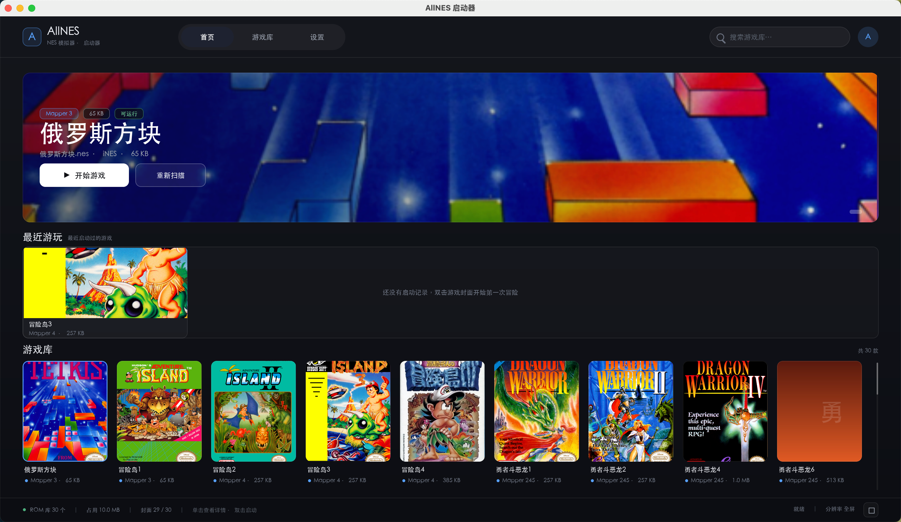
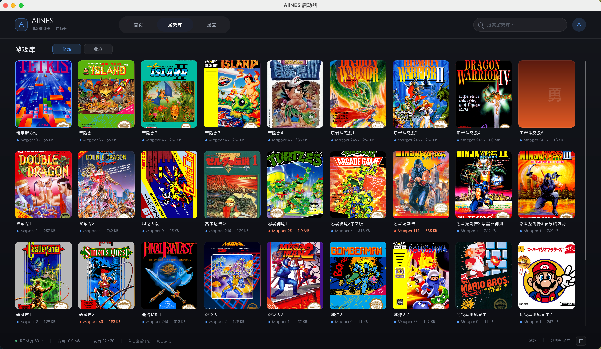
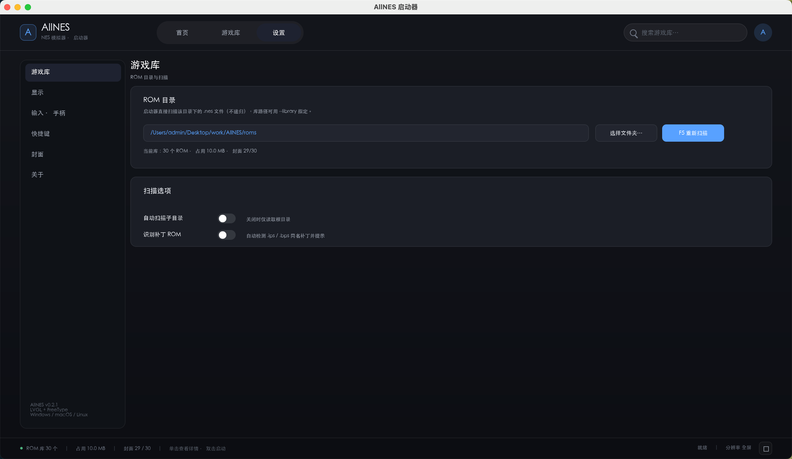

# AllNES

一个使用 C++17 编写的跨平台 NES（FC）模拟器。采用与平台无关的内核和可替换的
前端分层设计，Linux、 Mac桌面前端使用 SDL2。

- 前端：SDL2（macOS / Linux / Windows）
- 内核：纯 C++17，不包含任何平台头文件
- 已在 Ubuntu 22.04（g++ 11.4、CMake 3.22）与 macOS 上编译、运行和测试

## 界面预览

<p align="center">
  
</p>
<p align="center">
  
</p>
<p align="center">
  
</p>

## 特性

- 6502 CPU、逐扫描线 PPU、APU（两个方波、三角波、噪声、DMC）
- NMI / IRQ、OAM DMA、DMC DMA
- iNES 格式，mapper：NROM(0)、MMC1/SxROM(1)、UxROM(2)、CNROM(3)、
  MMC3(4)、AxROM(7)、ColorDreams(11)、GxROM(66)、MMC3 变种(245，
  勇者斗恶龙等中文改版卡带)
- 键盘双人操作，支持最多两个手柄（热插拔，1P/2P 各一个）；第三方手柄
  （GameSir、8BitDo X 输入模式等）不在 SDL 内置映射库里时，自动套用通用
  Xbox 映射
- 音频：APU 原生采样率约 894 kHz，由前端重采样到设备采样率
- 保持宽高比的缩放：默认按窗口/屏幕的关键边铺满（全屏时高度铺满，左右留
  黑边），可选用 `--integer-scale` 强制整数倍；全屏、静音、帧率控制
- 图形启动器：深色卡片网格、封面横幅、最近游玩、实时搜索、分辨率切换，
  游戏详情以抽屉形式按需弹出；UI 基于 LVGL 10，通过独立的 display 抽象层
  呈现（SDL2 与 headless 后端），不依赖模拟器内核
- LVGL UI 直接使用 FreeType 加载系统中文字体；display 层可替换为
  SDL2 / headless，后续可扩展 OpenGL、FFmpeg 等后端而不改 UI
- 封面图直接读取 PNG/JPEG（内置 stb_image，无 SDL2_image 依赖），
  没有封面时按 ROM 名生成像素风占位图
- 无窗口的 `allnes_headless` 工具，可在 CI 中做确定性回归测试

## 构建

要求：CMake ≥ 3.12、支持 C++17 的编译器、SDL2。启动器 UI 还需要
FreeType（字体渲染）；找不到 LVGL/FreeType 时启动器不构建，直接传 ROM
仍可运行模拟器。

### macOS

```sh
brew install cmake sdl2 freetype
cmake -S . -B build -DCMAKE_BUILD_TYPE=Release
cmake --build build -j
```

### Ubuntu / Debian

```sh
sudo apt install build-essential cmake libsdl2-dev libfreetype-dev
cmake -S . -B build -DCMAKE_BUILD_TYPE=Release
cmake --build build -j
```

`libfreetype-dev` 用于 LVGL UI（默认开启，可用 `-DALLNES_WITH_LVGL=OFF`
关闭）。启动器不使用 SDL2_ttf。

如果没有 root 权限，可以把 `libsdl2-dev` 包解压到用户目录，然后指向它：

```sh
apt-get download libsdl2-dev
dpkg-deb -x libsdl2-dev_*.deb "$HOME/opt/sdl2"
cmake -S . -B build -DCMAKE_BUILD_TYPE=Release -DSDL2_ROOT="$HOME/opt/sdl2/usr"
cmake --build build -j
```

CMake 会优先使用 SDL2 的 CMake package；当 package 中的绝对路径失效时，
会回退为按 `SDL2_ROOT` 直接查找头文件和库。

## 运行

直接传 ROM 时保持一次性启动：

```sh
./build/host/allnes path/to/game.nes
```

不传 ROM 时打开图形启动器：

```sh
./build/host/allnes --library "$HOME/roms"
./build/host/allnes --display headless --library "$HOME/roms"   # 无窗口
```

`--display` 选择启动器的显示后端：`auto`（默认，等同 `sdl`）、`sdl` 或
`headless`。headless 后端不建立窗口，用于 CI 和无头截图，画布固定为
1920×1080。
启动器会直接扫描库目录（不递归）里的 `.nes` 文件。没有 `--library` 时使用
上次保存的目录；第一次运行则使用当前目录下的 `roms/`（若存在），否则使用
当前目录。库路径、分辨率和最近启动的游戏保存在
`~/Library/Application Support/AllNES/AllNES/launcher.conf`（macOS）、
`$XDG_DATA_HOME/AllNES/AllNES/launcher.conf` 或
`~/.local/share/AllNES/AllNES/launcher.conf`（Linux）、
`%APPDATA%/AllNES/AllNES/launcher.conf`（Windows），下次自动恢复。

界面按 1920×1080 逻辑画布设计（窗口默认 1600×900，可缩放，最小 960×540）：
顶部是首页 / 游戏库 / 设置三个页签和搜索框；首页有选中游戏的横幅、
“最近游玩”和一行游戏库预览；游戏库页是 9 列封面网格。右侧详情面板默认
隐藏，单击任意游戏卡片（或“最近游玩”卡片）时作为抽屉弹出，显示封面、
mapper、文件大小、运行状态、分辨率和启动按钮；按 `Esc` 或点右上角 `×`
关闭，切换页签时也会自动关闭。键盘方向键只移动选择，不会弹出面板。
底部状态栏显示数量、占用空间和当前分辨率。

LVGL UI 把 `third_party/lvgl/` 当作只读的第三方依赖：CMake 以
`LV_BUILD_CONF_PATH` 指向项目自己的 `launcher/lvgl/lv_conf.h`（启用 FreeType、
stdio 文件系统 `A:`、CLIB 分配器和 PNG/JPEG 解码器），并关闭 examples、
demos、ThorVG 与 LVGL 自带测试。

UI 与窗口之间是 `launcher/display/` 抽象层：

- UI 只负责 LVGL 控件树、布局和状态机，不 include SDL，也不直接读事件；
- display 层负责窗口/上下文、脏矩形上传、`present()`、事件归一化、计时、
  全屏和像素回读；像素格式统一为 ARGB8888（`0xAARRGGBB`）；
- SDL 后端窗口默认 1600×900 点、支持 HiDPI；Retina 上以 2 倍画布
  （3840×2160）渲染再降采样，文字和封面明显更锐利；
- headless 后端不开窗口，用同一接口提供整幅 ARGB 帧，供 CI 截图和未来的
  FFmpeg 录制后端复用。

新增后端只需实现 `launcher/display/display.h` 的 `Display` 接口，在
`createDisplay()` 里注册并扩展 `--display` 的取值；UI 与 host 不需要改动。

### 游戏库与封面

启动器扫描 `--library` 目录（默认 `roms/`）顶层的 `.nes` 文件，目录结构如下：

```
roms/
├── 魂斗罗.nes
├── 勇者斗恶龙4.nes
└── images/
    ├── 魂斗罗.png
    └── 勇者斗恶龙4.png
```

封面图放在游戏库目录的 `images/` 子目录，文件名与 ROM 相同，扩展名可以是
`.png`、`.jpg` 或 `.jpeg`。建议使用 3:4 的竖版图；没有封面的游戏会按文件名
生成一张像素风占位图。

仓库本身不包含 ROM 和封面图，请使用自己合法持有的游戏文件。

启动器按键：

| 键                                  | 作用                                                 |
| ----------------------------------- | ---------------------------------------------------- |
| `Tab`                             | 切换首页 / 游戏库 / 设置                             |
| `↑`/`↓`、`W`/`S`          | 按行移动选择（9 款）                                 |
| `←`/`→`、`A`/`D`          | 逐个移动选择                                         |
| `PgUp`/`PgDn`、`Home`/`End` | 翻页 / 跳到首尾                                      |
| `/`                               | 聚焦搜索框（输入即过滤，`Backspace` 删除）         |
| `Enter`                           | 启动选中的游戏                                       |
| `[` / `]`                       | 切换分辨率档位（立即保存）                           |
| `F5`                              | 重新扫描游戏库                                       |
| `F11`                             | 启动器全屏切换                                       |
| `Esc`                             | 清除搜索 / 退出搜索 / 关闭详情抽屉 / 关闭启动器      |
| `Ctrl+Q`                          | 退出整个程序                                         |
| 鼠标 / 触摸                         | 悬停预览；单击选中并弹出详情抽屉；双击启动；滚轮滚动 |

启动器也支持手柄导航（第一个手柄）：

| 手柄按键                  | 作用                         |
| ------------------------- | ---------------------------- |
| 十字键 / 左摇杆           | 移动选择（长按自动连续滚动） |
| A（Xbox）/ ×（PS）       | 启动选中的游戏               |
| B（Xbox）/ ○（PS）       | 返回 / 关闭详情 / 退出启动器 |
| X（Xbox）/ □（PS）       | 重新扫描游戏库               |
| Y（Xbox）/ △（PS）       | 切换首页 / 游戏库 / 设置     |
| Back（Xbox）/ Share（PS） | 启动器全屏切换               |
| Start / Options           | 启动选中的游戏               |
| LB / L1、RB / R1          | 切换分辨率档位               |

分辨率档位（游戏窗口尺寸）：3x 768×720（默认）、4x 1024×960、
5x 1280×1200、1920×1080、2560×1440、全屏。游戏画面仍在窗口内做整数倍
缩放并保持宽高比。

常用参数：

| 参数                                   | 说明                                                |
| -------------------------------------- | --------------------------------------------------- |
| `-s, --scale N`                      | 窗口缩放倍数，默认 3                                |
| `-w, --width N` / `-H, --height N` | 指定窗口尺寸                                        |
| `-C, --conf FILE`                    | 指定按键配置文件                                    |
| `-L, --library DIR`                  | 启动器的游戏库目录                                  |
| `--display auto\|sdl\|headless`        | 选择启动器的显示后端（默认 `auto`）               |
| `--fullscreen`                       | 全屏启动                                            |
| `--integer-scale`                    | 整数倍缩放（每个 NES 像素等大，但可能留更宽的黑边） |
| `--mute-audio`                       | 不打开音频设备                                      |
| `--frames N`                         | 运行 N 帧后退出（用于冒烟测试）                     |
| `--menu-frames N`                    | 绘制 N 帧启动器后退出（用于冒烟测试）               |

游戏内快捷键：`F11` 切换全屏，`Ctrl+R` 复位，`M` 静音切换，`Ctrl+Q`
退出整个程序。从启动器进入游戏时，按 `Esc` 或点击游戏窗口的关闭按钮会先
弹出确认框，可选择**返回启动器**、**退出到桌面**或**取消**（继续游戏），
避免误关窗口连启动器一起退出；直接传 ROM 启动时 `Esc` / 关闭窗口仍然
直接退出。

默认按键（可在 `keybindings.conf` 中修改）：

| NES 按键          | 玩家 1        | 玩家 2   |
| ----------------- | ------------- | -------- |
| A                 | J             | 小键盘 5 |
| B                 | K             | 小键盘 6 |
| Select            | 右 Shift      | 小键盘 8 |
| Start             | Enter         | 小键盘 9 |
| 上 / 下 / 左 / 右 | W / S / A / D | 方向键   |

## 测试

```sh
ctest --test-dir build --output-on-failure
```

测试 ROM 由 `tools/make_test_rom.py` 现场生成（一个 16 KB PRG + 8 KB CHR 的
NROM 程序，绘制 8 像素宽的黑白竖条纹），不依赖任何受版权保护的游戏。

也可以手动运行无窗口工具：

```sh
# 检查画面、重复运行检查确定性、输出帧哈希
./build/tools/allnes_headless --rom build/tools/test_stripes.nes \
    --frames 5 --check-stripes --repeat 2 --hash

# 导出最后一帧为 PPM
./build/tools/allnes_headless --rom game.nes --frames 60 --dump-ppm frame.ppm
```

`launcher_model` 测试覆盖 ROM 头探测、目录扫描/排序、路径展开和配置读写；
`display_headless` 测试覆盖 display 接口的脏矩形拷贝、裁剪、像素格式和
生命周期。两者都不依赖窗口系统。

在没有显示服务器的机器上，可以用 headless 后端或 SDL 的 dummy 驱动做前端
冒烟测试：

```sh
./build/host/allnes --display headless --library build/tools --menu-frames 5

SDL_VIDEODRIVER=dummy SDL_AUDIODRIVER=dummy \
    ./build/host/allnes --frames 60 --mute-audio build/tools/test_stripes.nes

SDL_VIDEODRIVER=dummy SDL_AUDIODRIVER=dummy \
    ./build/host/allnes --display sdl --library build/tools --menu-frames 5
```

启动器支持下面的调试用环境变量，便于无头截图和交互验证：

| 变量                              | 作用                                                            |
| --------------------------------- | --------------------------------------------------------------- |
| `ALLNES_LAUNCHER_SHOT=FILE`     | 把启动器画面保存为 PNG                                          |
| `ALLNES_LAUNCHER_SHOT_FRAME=N`  | 在第 N 帧截图（默认第 0 帧）                                    |
| `ALLNES_LAUNCHER_TAB=0/1/2`     | 启动时直接打开首页 / 游戏库 / 设置                              |
| `ALLNES_LAUNCHER_DETAILS=1`     | 启动时直接打开右侧详情抽屉（截图用）                            |
| `ALLNES_LAUNCHER_INPUT_DEBUG=1` | 把鼠标/触摸的事件坐标、drawable 尺寸与最终画布坐标打印到 stderr |

```sh
ALLNES_LAUNCHER_TAB=1 ALLNES_LAUNCHER_SHOT=/tmp/launcher.png \
    ./build/host/allnes --display headless --library roms --menu-frames 2
```

## 目录结构

```
AllNES/
├── core/                 # 与平台无关的模拟器内核
│   ├── include/port/     # IVideoSink / IAudioSink / IInputSource
│   ├── include/          # CPU、PPU、APU、main bus、mapper……
│   └── src/
├── gamepad/              # SDL 手柄封装：枚举、热插拔、第三方手柄通用映射
├── launcher/             # 独立启动器层（不依赖 core）
│   ├── model/            # ROM 扫描、iNES 头探测、配置持久化
│   ├── display/          # 显示抽象层：Display 接口 + SDL2 / headless 后端
│   ├── ui/               # LVGL 界面层：控件树、布局、状态机、截图
│   ├── lvgl/             # 项目自己的 lv_conf.h（LVGL 配置）
│   ├── tests/            # 模型单测 + headless display 单测
│   └── types.h           # LaunchRequest（host 与 UI 的边界类型）
├── host/                 # SDL2 组合根（启动器 + 模拟器主循环）
├── third_party/
│   ├── lvgl/             # vendored LVGL 10（原样保留，不改源码）
│   └── stb_image*.h      # 封面解码与 PNG 截图
├── tools/                # 无窗口运行器与测试 ROM 生成器
├── docs/
│   ├── ARCHITECTURE.md   # 分层与数据流说明
│   └── images/           # README 界面截图
└── keybindings.conf
```

## 已知限制

- 只支持 NTSC iNES ROM；PAL、UNIF、带 trainer 的 ROM 会拒绝加载。
- 没有存档/即时存档、没有电池存档持久化。
- 音频使用简单线性重采样与队列水位控制，不是逐周期精确的 APU 混合。
- 部分边缘 PPU 行为（例如渲染中途关闭/开启的精确时序）采用近似实现。

## 许可证

本项目按 **GPL-3.0** 发布，见 `LICENSE`。
